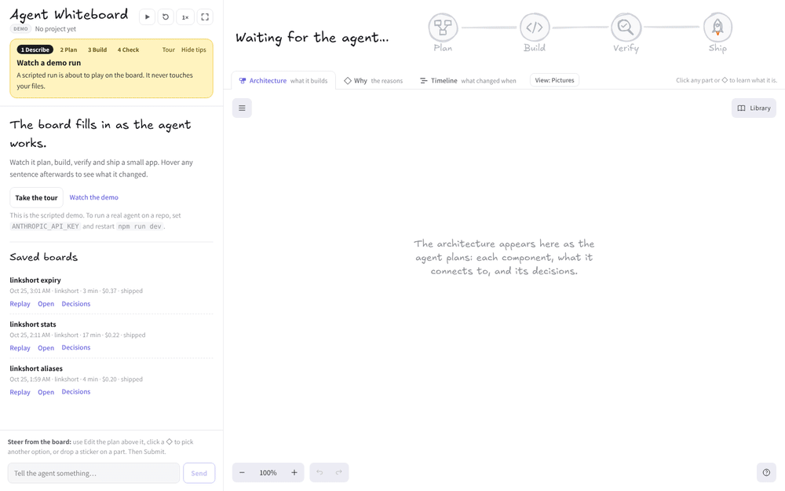
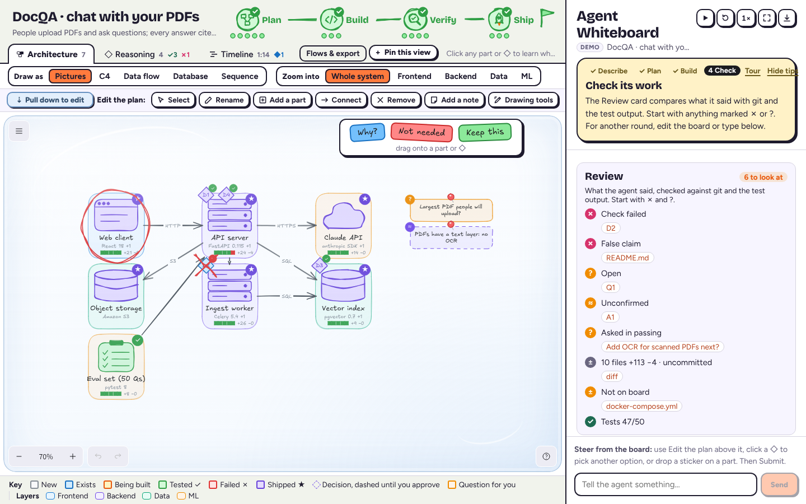

# Agent Whiteboard

A real coding agent works in a repo while an Excalidraw board shows what it's doing: its plan, the parts of the system it's touching, and how far along it is. You steer it by editing the board.

**New here?** Read the [step-by-step tutorial](docs/TUTORIAL.md) (no API key needed), or open the app and press **Take the tour**.



The board is pictures, not prose. Components are hand-drawn pictograms (browser window, server rack, database cylinder, cloud, queue, clipboard, person) with a short name; status is color plus a corner badge (… building, ✓ verified, ✗ failed, ★ live). Above the board, the project's name and goal sit beside the four phases, drawn as milestones on a road (Plan → Build → Verify → Ship) with a dot per task: hover one to read it, click to open it in Plan details. Below that, the board has a tab per canvas: **Architecture** (what's being built; edit it to steer), **Why** (the reasoning behind it) and **Timeline** (how that reasoning moved over the run). Words stay in the side panel.

## Take the tour

New here? Press **Take the tour** (on the start screen, as **Tour** beside the coach's Hide tips, or the flag button by **?**). The scripted demo plays as a lesson: no API key, nothing touches your files. It stops at each step until you've tried it, then carries on: click a ◇ decision, pick another option with **Use this** (or drag a sticker onto a part), answer its question, **Approve with changes**, hover a log line while it builds, answer a command prompt (**Allow once**, **Allow all** or **Deny**, and *Why am I asked?*), open **Why** when a check fails and the decision changes, find the claim that isn't true (the ✗ row in the review, or the red pen), and read the **Timeline**. Twelve steps; Back, Skip step (it does the step for you) and Exit tour are on the card. A first visit offers it once.


## First-time help

The app walks a newcomer through a run without hiding anything. **Hide tips** turns the coach and the board tips off (remembered); the **?** button brings them back.


- **Coach.** A yellow card at the top of the panel says which step you're on (Describe → Plan → Build → Check) and what to do now, in a sentence or two.
- **Tips on the board.** The first time a plan waits for you, sticky notes with hand-drawn arrows point at a decision ("Click a ◇ to see its other options") and a part ("Click a part to learn what it is"), and an orange circle rings its first open question. Click one to dismiss them. They're never exported or sent to the agent.
- **Glass.** The board sits behind glass (a faint sheen, like a fishbowl): you can look and click anything to learn what it is, but drags, deletes and typing don't reach it. **Pull down to edit** slides the glass away and shows Edit the plan; **Submit** sends your changes and puts the glass back (**Glass back up** does without sending). Use this, Rename and Remove on a card pull it down for you.
- **Edit the plan.** With the glass down, a toolbar with words above the board: Select, Rename, Add a part, Connect, Remove, Add a note, Stickers. Each picks the matching Excalidraw tool and says what to do next; the gestures (double-click, Delete, drawing) still work. Excalidraw's full toolbar is behind **Drawing tools**.
- **Click to explain.** Select a part, a ◇, an arrow or a question and a card says what it is in plain words (what a service is, its status, routes, files, decisions, connections), with its actions as buttons: Rename, Remove, Ask about it, See the code; for a decision, **Use this** on each option, Ask why and Reject it; for a question, its answers.
- **Plain words.** Symbols come with a word: receipts read "✓ checked", "✗ not true", "? can't tell"; the panel's tabs are **Chat & log** and **Plan details**, with counts like "2 for you"; each board tab says what it's for; a key under the Pictures board says what the colors mean; a command prompt says what the command is for and why you're asked; at the plan gate, suggested questions ("Ask why: D1 …") start a message.

## Views and exports

The bar above the board shows the same plan other ways:

- **Draw as** picks the notation (remembered):

  | Draw as | What it shows | Editable |
  | --- | --- | --- |
  | Pictures | Pictograms: what each part is at a glance | Yes |
  | C4 | [C4](https://c4model.com) container boxes: `[Container: FastAPI 0.115]`, `[Database: …]`, `[External system]` | Yes |
  | Data flow | A data flow diagram (Gane-Sarson): numbered processes, data stores (DS1…), external entities with a shadow, and the data each link carries | Yes |
  | Database | Each data store's tables (an ER diagram): columns and types, PK/FK/UK keys, crow's-foot relations | Read-only |
  | Sequence | One flow as a UML sequence diagram: lifelines, numbered messages, replies dashed | Read-only |

  The editable ones redraw the same board, so steering works in all three. C4, Data flow, Database and Sequence use the official look: square boxes, 1 px lines, a plain typeface and a Key. Status is color everywhere.
- **Zoom into** opens one **layer** (Frontend, Backend, Data, ML, External) on the board's own map: each of its components becomes a frame holding its parts (pages, routes, jobs, pipeline steps, tables with their columns), with arrows for what each hands on; components of other layers stay closed, as grey boxes in their places. **ML** gathers the model pipeline even where its steps live inside backend components (chunk → embed → index, retrieve → prompt → answer). **Look inside** on a part's card opens its layer. Read-only; **Whole system** goes back.


**Flows & export**, beside the board tabs:

- **Show a flow**: the path a request takes, its steps numbered on the arrows and listed in a card. In Sequence it picks the flow.
- **Export** what the board shows: **Copy Mermaid** (each view has its Mermaid form: flowcharts, `erDiagram`, `sequenceDiagram`, and a flowchart with a subgraph per component for a layer; GitHub renders them in a README or PR), **SVG** or **PNG** with a title.

The agent supplies what these need: flows (`flow` op), tables (`table` op), each component's layer, and the parts inside components (`part` op: name, kind, its layer when it differs, and what it hands on). A component with no parts shows what it exposes (its `api`) and its tables. The Plan details lists the flows and the data model too, and names are kept in sentence case.

## Setup

Needs Node 20+ and git.

```bash
git clone https://github.com/ghanemja/whiteboard.git
cd whiteboard
npm install                  # also copies Excalidraw's fonts into public/fonts
npm run sandbox              # a safe repo to try: sandbox/linkshort (run again to reset)
cp .env.example .env.local   # optional: set AGENT_URL / AGENT_KEY / AGENT_MODEL to run a real agent
npm run dev                  # http://localhost:5199
```

- **Nothing set:** a scripted demo plays.
- **With a model** ([Models](#models): a key for Anthropic's API, or a URL for anything else): the repo field starts at the sandbox (or `AGENT_REPO`); point it at any local folder, describe a task, start. A [Claude Agent SDK](https://code.claude.com/docs/en/agent-sdk) session works in that folder and asks before every shell command.
- **Saved runs:** `cp fixtures/recordings/* recordings/` adds three real runs under "Saved boards".
- **Tests:** `npm test`.
- **Settings** (`.env.local`): `AGENT_URL`, `AGENT_KEY`, `AGENT_MODEL` ([Models](#models)), `AGENT_EFFORT` (default `low`), `AGENT_REPO` (default repo).

## Models

Three settings in `.env.local`. Leave them all empty and the scripted demo plays.

| Setting | What it is |
| --- | --- |
| `AGENT_URL` | Where the model is. Leave it empty for Anthropic's API. Anything that speaks the Anthropic Messages API works. |
| `AGENT_KEY` | Its key. Leave it empty for a local server. |
| `AGENT_MODEL` | The model's name there (default `claude-opus-5-5`). |

| To use | `AGENT_URL` | `AGENT_KEY` | `AGENT_MODEL` |
| --- | --- | --- | --- |
| Anthropic's API | | your API key | |
| A local model with [Ollama](https://docs.ollama.com/api/anthropic-compatibility) 0.14+ | `http://localhost:11434` | | `qwen3-coder` |
| OpenAI, Gemini and others through [LiteLLM](https://docs.litellm.ai/docs/proxy/client_setup/claude_code) | `http://localhost:4000` | its key | a `model_name` from its config |
| Many models through [OpenRouter](https://openrouter.ai/docs/guides/guides/claude-code-integration) | `https://openrouter.ai/api` | your OpenRouter key | e.g. `moonshotai/kimi-k2` |

Restart `npm run dev` after changing them; the top bar shows where the agent is running. For Ollama, first run `ollama pull qwen3-coder` and start the server with enough context: `OLLAMA_CONTEXT_LENGTH=64000 ollama serve`.

- **How it works:** the agent is the [Claude Agent SDK](https://code.claude.com/docs/en/agent-sdk) (the engine behind Claude Code): its file and shell tools, permission prompts, plan mode and the board's `update_board` tool. The server passes these three settings to it as the variables it reads. For a URL other than Anthropic's, the same model also does the SDK's background work.
- **Non-Claude models are unofficial.** The board needs a model that calls tools reliably, because it draws only through `update_board`. A weaker model may write the code but draw little on the board. Use the strongest coding model you can run, with at least 64K of context. Only Anthropic's API has been tested with this app so far.
- **Claude on Bedrock, Vertex AI or Foundry:** set Claude Code's own variables instead (`CLAUDE_CODE_USE_BEDROCK=1` and AWS credentials, `CLAUDE_CODE_USE_VERTEX=1` with `CLOUD_ML_REGION` and `ANTHROPIC_VERTEX_PROJECT_ID`, `CLAUDE_CODE_USE_FOUNDRY=1` with `ANTHROPIC_FOUNDRY_RESOURCE`); see the [Bedrock](https://code.claude.com/docs/en/amazon-bedrock), [Vertex AI](https://code.claude.com/docs/en/google-vertex-ai) and [Foundry](https://code.claude.com/docs/en/microsoft-foundry) guides. The `ANTHROPIC_*` variables Claude Code reads also work.
- **Other coding agents (Codex, opencode, pi):** not supported yet. They're separate agents, not models; the likely path is a board MCP server any of them can add.

## What happens in a run

1. **Plan.** The agent starts in plan mode: it can read the repo but not change it. It draws the components the task involves (existing ones blue, new ones grey) and their connections, then asks to exit plan mode. That request waits for you: the board shows ⏸ on the Plan milestone.
2. **Review.** Edit the board (see [Steering from the board](#steering-from-the-board)) or type a request. **Revise plan** (or **Submit** on the board) sends your changes back so the agent re-plans; **Approve with changes** folds them in and goes on to build; **Approve plan & build** goes straight on.
3. **Build and verify.** The agent edits files (allowed automatically inside the repo) and the component that owns each file turns orange. It asks before every shell command: **Allow once**, **Allow all** for the rest of the run, or **Deny**. Components turn green when verified, purple ★ when done.
4. **Afterwards** the session stays open: board edits and messages become new turns. Stop the agent with ■, start over with ↺. Closing the tab stops it, and an idle agent stops after 15 minutes.

## Steering from the board

Edit the board; each change is sorted by what you touched:

| | Area | Edit |
| --- | --- | --- |
| ▢ | Architecture | rename (double-click a name), delete, draw a box, draw an arrow between two |
| ◇ | Decision | select a diamond → its alternatives fan out → drag one onto it (or type your own in the blank one); delete a diamond to reject it |
| ✐ | Scope | drop a text note ("English PDFs only") |
| ▢ ◇ ✐ | Stickers | drag **Why?**, **Not needed** or **Keep this** from the sticker sheet onto a part or a ◇ |

Queued changes show in the panel by area, and **Submit** (panel, or floating on the board with ▢ ◇ ✐ counts) sends them. While the agent works they go after its current step. The agent gets each edit with its area; the decision log lists them the same way. In Plan details, clicking an alternative under **Over** picks it too. A picked option sits beside its diamond in blue until the agent applies it; delete it to undo.

### Stickers


**Stickers** in Edit the plan opens Excalidraw's Library with a sheet of three stickers. Drag one onto a part or a decision diamond:

| Sticker | On a part | On a ◇ | Area |
| --- | --- | --- | --- |
| **Why?** | the agent explains why the part is needed (and offers to drop it if it can't) | it justifies the decision with the evidence | ▢ / ◇ |
| **Not needed** | remove it | reject it | ▢ / ◇ |
| **Keep this** | leave it as it is: no renaming, removing or reworking without asking you | don't change that decision | ✐ |

A sticker queues like any other edit and goes with **Submit** (or Revise / Approve with changes). Once the agent has answered, Why? and Not needed come off the board; Keep this stays as a standing constraint (the agent sees it in every message's board state) until you delete it. A sticker dropped on empty board is just a drawing: nothing is sent.

## Marks on the board

- **Red pen on the review.** When a run ends, the board gets marked like homework: a rough red ring round the part that owns a file a false claim names, a red ✗ scribbled over a decision whose check failed (it comes off once a later test run proves it), and, for a false claim about a file no part owns, a red note under the board ("✗ README.md · not on the board"). Click a mark to open its sentence or its decision. The marks go when the next round starts; they're never exported.
- **Tape and pins.** Your notes are taped to the board with a strip of washi tape; the agent's questions and assumptions are pinned up with a red push pin, so whose note is whose shows at a glance. C4 and Data flow are flat diagrams, so they go without. Exports include them.



## The reasoning behind the plan

The board shows what is being built; the **Plan** tab shows why.

- **Goal:** one line on what the task is for.
- **Architecture:** each component with its libraries and versions, the interface it exposes (routes, functions, tables) and the files that own it. On the board, libraries are a small caption under the pictogram.
- **Connections:** how two parts talk (HTTP, queue, SQL, call…) and the exact API on that edge. On the board, the protocol is a short tag on the arrow.
- **Decisions:** the few technical choices that shaped the plan. Each says what was chosen, the real alternatives it beat, why (the deciding reason and the cost accepted), evidence from the repo, which components it affects and which earlier decisions it builds on. On the board each is a numbered diamond (D1, D2…) on the component it affects most, with dotted ties to the others: dashed while proposed, solid once you approve, blue when changed, grey when rejected.

To push back, **Ask why** on a decision starts a message ("About D1 …") for you to finish; on the board, pick another of its options or delete the diamond to reject it. When the agent changes a decision, because you challenged it or because verification proved it wrong, the card keeps the old choice struck through under **Before** and says what caused the change under **Because**. Selecting a component on the board scrolls Plan details to it.

Every decision also names its **check**: how we'll know it was right, usually a test by name. Its result is drawn on the diamond: ✓ proven, ✗ failed. The agent reports proofs after running the tests, and the server compares them with the test runner's own output (node --test, Jest/Vitest, pytest -v, go test -v). Where the output disagrees, the output wins and the agent is told. Later test runs keep re-checking, so a regression crosses a diamond again. A decision whose choice changes goes back to unchecked.

The **Why** tab draws each decision as a chain: evidence (files from the repo, facts, your request, a failed check) → the decision → the components it shapes → its proof. Dashed purple links show which decisions build on which. It's drawn from the decisions, so it's read-only: pan and zoom it, and click a row to open that decision in Plan details. The tab itself counts the decisions and how many are proven (✓) or failed (✗).

The **Timeline** tab answers "what changed, when, and because of what?" across the run, left to right with mm:ss ticks:

- **You** (top): a pink mark for each thing you did: the start, a message (a **?** when it challenges a decision, with the decision named above it), approving the plan, board edits (their count), and each command you allowed or denied.
- **Tests:** a ✓ or ✗ for every test run (a command like `npm test`, `pytest` or `go test`, or one that printed per-test results), with its pass count when the runner printed one.
- **One lane per decision:** a dashed diamond when it's proposed and a dashed lane while the plan isn't approved; the lane turns solid when you approve (a faint line drops from your approval to the decisions it made solid). A blue diamond marks a change, with an arrow from what caused it: from your message, or from the ✗ of the check that failed. When one message changes several decisions, the arrow goes to the one you asked about and dashed arcs ripple from it to the rest. A ✓ or ✗ is its check's result; a dotted tie leads up to the test run that ticked it. A grey diamond ends the lane when it's rejected.
- **Phases** (bottom): Plan, Build, Verify and Ship as segments in the milestone colors, with a flag when it shipped.

Waits longer than 15 seconds (reading the plan, a permission you hadn't answered yet) are drawn short, with a break on the axis that says how long they were, so a long pause doesn't flatten the rest. An orange line marks now. During a live run the Timeline grows as events arrive and keeps the whole run in view, unless you've panned or zoomed it (⛶ fits it again). Click a decision's mark to open its card in Plan details, one of your marks to see that message, or a test run to see its command. The tab shows the run's length and how many times a decision changed (◆).

## Checking what it says

Don't take the agent's word for it. Glyphs and counts, details on hover:

- **Receipts.** After a checkable claim: ✓ checked, ✗ not true (with the one wrong thing, e.g. "✗ not true: README.md"), ? can't tell. Test claims vs the runner's counts, file claims vs git, "I ran X" vs the commands run. ✗ comes only from the runner or git. Chat & log tab: ✗ n not true.
- **What it changed.** Git, not the agent's summary: the working tree vs how the run found it (untracked included, your index untouched). Components show +/− blocks; Plan details → **Code** has every diff by component, plus files **not on board**.
- **Questions and assumptions.** "?" and "≈" sticky notes. Plan details → **For you**: pick an option or type (↵), confirm ✓ or correct ✎. Ones only said in prose: **In passing**.
- **Highlights only.** Chat & log → Highlights only: keeps sentences that drew, claimed, asked or assumed; the rest fold to "⋯ n".
- **Review.** When a run ends: failed/unchecked checks, false or unverified claims, open questions, changed and unowned files, commits, last test run, denied commands. Each chip links to its card, sentence or diff.

The demo shows all five, including a false claim (a README it never touched) and a question buried in its summary.

## Saved boards and decision logs

Every run is saved in `recordings/` (git-ignored) while it happens:

- `<id>.jsonl`: every event with its time: what the agent drew, said, read, edited and ran, and what you did (approvals, board edits, messages, allowed or denied commands). It's also where the agent's session id is kept.
- `<id>.decisions.md`: a readable log of the development decisions. It's the handoff document for whoever picks the work up next. It opens with the current plan (goal, an architecture table with layers, libraries and interfaces, the diagrams as Mermaid (container view, data flow, data model, and each flow), connections, its questions and assumptions, the files it changed and which component owns each, and each decision with what it beat, why, its evidence, what it replaced and why, its check and its proof), then a timeline: the plan the agent proposed, what you approved, challenged or changed, every decision the agent revised, each decision proven or failed (by the agent or by a test run), every command you allowed, and how the run ended, each with its time.

The start screen lists saved boards. **Replay** plays a run back on the board at its own rhythm (long waits are shortened, and pause and speed work as usual). **Open** jumps straight to the finished board. **Decisions** opens the decision log. A finished live run also links to its replay and decision log.

In a replay the Timeline shows the whole run, with what hasn't happened yet faded and the now line following playback. It's a scrubber: click any moment (a mark, or anywhere along the axis) and the board, the phases and the panel jump to that point and pause there; play continues from it. Recordings made before the server recorded what caused a change still show it: a decision that changed right after you asked for something changed because of you (the Plan and Why tabs say so too), and a test run the agent said had failed counts as failed.

The panel lists what the agent actually did (files read and edited, commands and whether they passed) and links each row to the component it touched. Hover a sentence or row to highlight it on the board; select a component to find what changed it.

The agent loads the repo's project settings and `CLAUDE.md`, not your global Claude Code settings or hooks. It's told never to push, publish or deploy; "Ship" means tests pass and docs match.

## How it fits together

| File | Role |
| --- | --- |
| `server/runs.js` | One Agent SDK `query()` per run: the in-process `update_board` MCP tool, plan gate and permission prompts via `canUseTool`, activity events, `/api/runs` endpoints |
| `server/recordings.js` | Writes each run to `recordings/` (events + decision log), lists and serves them |
| `server/changes.js` | What a run changed in the repo, from git: working-tree snapshots through a throwaway index, and their diff |
| `server/instructions.js` | What the agent is told about the board (appended to the Claude Code system prompt) |
| `src/agent/live.js` | Browser side of `/api/runs`: start, follow the event stream, send approvals and messages |
| `src/engine/session.js` | Routes agent events to the board and the transcript; plan gate and permission state; keeps the run's timed events for the Timeline and seeks replays |
| `src/engine/board.js` | Owns the three Excalidraw canvases: the Architecture pictograms and decision diamonds, the Why chains, the Timeline, highlighter marks, and `diff()` of your edits |
| `src/engine/timeline.js` | The Timeline as pure functions: `buildTimeline(events)` (lanes, marks, causes, the time axis with compressed waits), `timeToX`, `drawTimeline` (Excalidraw skeletons) |
| `src/engine/palette.js` | Phases and the colors the canvases share |
| `src/engine/views.js` | The views of one model, shared with the server: C4 labels, layers and what's inside them (parts, links), flows, data-flow roles and numbering, table columns, sentence case, and every Mermaid export |
| `src/engine/diagrams.js` | The read-only diagrams as Excalidraw skeletons: the data model (ER), a flow as a sequence diagram, and a layer zoomed into |
| `src/engine/claims.js` | Receipts: finds checkable claims in the agent's sentences (and questions or assumptions said in passing) and checks them against the run's record |
| `src/engine/review.js` | The end-of-run review card: what needs a look, and where; and the red-pen marks for the board |
| `src/engine/stickers.js` | The steering stickers: what a dropped sticker lands on, and the edit it makes |
| `src/engine/tour.js` | The guided tour as pure functions: the steps, when each is done, where it points, when the demo waits for you |
| `src/PhaseHeader.jsx` | The journey above the tabs: title, goal, milestones and task dots, drawn with roughjs (Excalidraw's renderer) |
| `src/engine/transcript.js` | Sentences and activity rows, each linked to the board items it touched |
| `src/engine/parser.js`, `player.js`, `src/agent/script.js`, `replies.js` | The scripted demo (inline `<board/>` tags typed out at reading pace) |
| `scripts/make-sandbox.mjs` | Creates the sample repo |
| `scripts/tour-check.cjs` | Takes the tour end to end in headless Chromium (Playwright) with screenshots, then checks the plain demo is unchanged |
| `test/*.test.js` | `npm test`: the Timeline over the sample runs in `fixtures/recordings/`, claims and receipts, the review card, stickers and the red pen, the tour's steps, the views and their Mermaid exports, the decision log's diagrams, and git change tracking on a throwaway repo |

Board ops (`update_board` tool and demo tags alike): `project`, `phase`, `task`, `node` (with `layer`), `part`, `edge`, `flow`, `table`, `decision`, `question`, `assumption`, `status`, `rename`, `note`, `remove`, `unlink`, `adopt`, `adopt-edge`, `adopt-note`. See `Board.apply()`. The demo's script also uses `diff` and `run` to stand in for what a live run gets from git and the test runner, and `ask` (a command prompt) and `tour` (a checkpoint) that only do something during the tour.

## License

MIT, see [LICENSE](LICENSE). The Claude Agent SDK it depends on has its own license (see that package).
