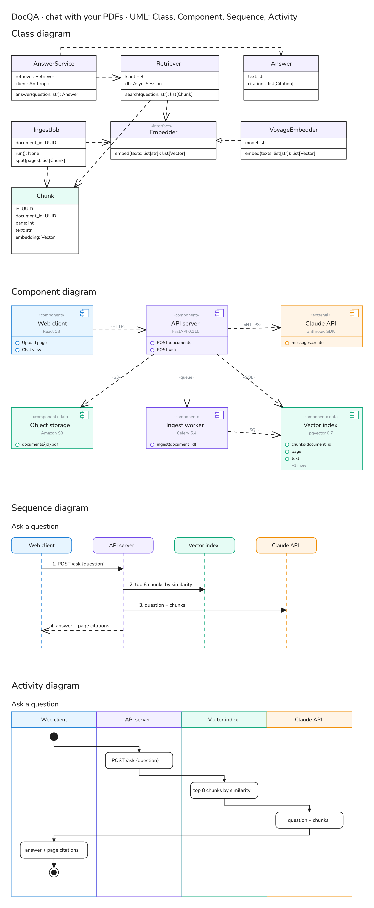
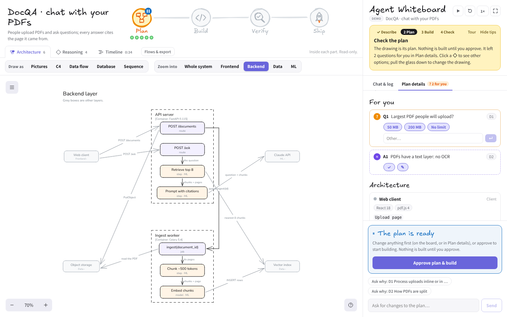
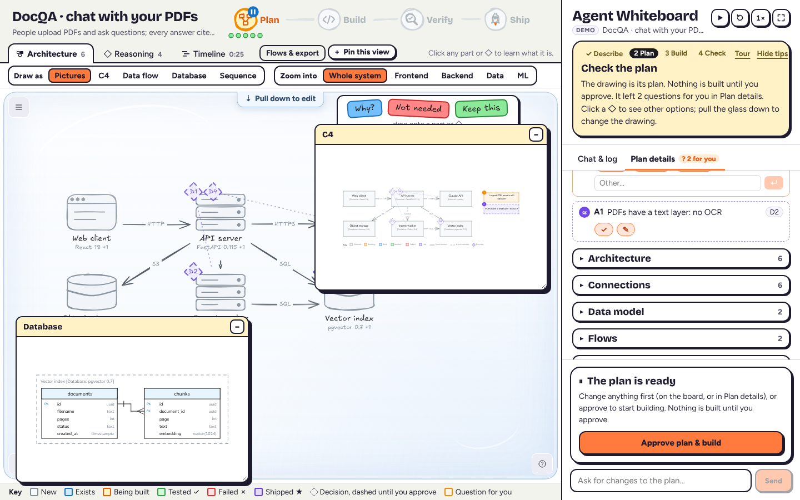
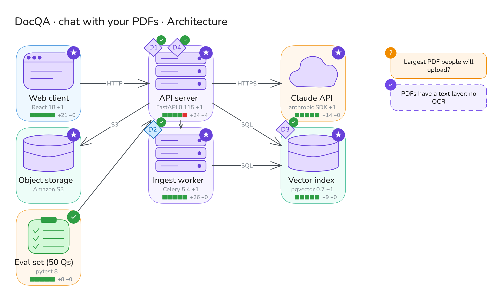

# Agent Whiteboard: the full reference

Everything about the app in one place. The [README](../README.md) is the short version.

A real coding agent works in a repo while an Excalidraw board shows what it's doing: its plan, the parts of the system it's touching, and how far along it is. You steer it by editing the board.

**New here?** Read the [step-by-step tutorial](TUTORIAL.md) (no API key needed), or open the app and press **Take the tour**.

![The scripted demo, under a minute, with a caption on every step and an orange ring on what to look at: an agent draws its plan for DocQA (a chat-with-your-PDFs app) as parts, connections and numbered decisions; you click D3 to read what it chose and why, press Use this on Pinecone, drop a Why? sticker on D1 and get the answer in a bubble beside it, and Approve with changes; it builds (each part orange, then green), asks before a test run, and D2 fails its eval, changes and is proven; the red pen marks a claim that isn't true (README.md); then the Reasoning tab, the Timeline, the plan as C4, Database and UML (class, component, sequence, activity), the ML layer opened up, and a Clean PNG export](../screenshots/ad/demo.gif)

The board is pictures, not prose. Components are hand-drawn pictograms (browser window, server rack, database cylinder, cloud, queue, clipboard, person) with a short name; status is color plus a corner badge (… building, ✓ verified, ✗ failed, ★ live). Above the board, the project's name and goal sit beside the four phases, drawn as milestones on a road (Plan → Build → Verify → Ship) with a dot per task: hover one to read it, click to open it in Plan details. Below that, the board has a tab per canvas: **Architecture** (what's being built; edit it to steer), **Reasoning** (why) and **Timeline** (how that reasoning moved over the run). Words stay in the panel on the right.

## The screen

The board takes the left of the window and the panel the right. Everything around the board has one look: paper, ink for text, outlines and hard shadows, one orange for actions, Bricolage Grotesque for headings and Figtree for reading. The boards themselves stay Excalidraw's hand-drawn sketch.

- **Above the board:** the project and its four phases; the tabs (**Architecture**, **Reasoning**, **Timeline**) with **Flows & export** and **+ Pin this view**; **Draw as** and **Zoom into**; and **Edit the plan**, with the glass switch first. While the plan is editable, the sticker tray sits at the board's top right. The color key runs along the bottom.
- **The panel's title bar:** a **Demo**, **Agent** or **Replay** badge (hover it to see the model and where it runs), then play or pause (■ stops a live agent), ↺ to start over, the speed (1×, 2×, 4×; not for a live agent), ⛶ to fit the board and ⇩ to download the log. With tips hidden, a flag (the tour) and **?** (tips) join them. Under the bar, a status line says what the agent is doing right now.
- **The panel, top to bottom:** the coach; the agent's latest reply (**Its reply**) or why it stopped (**⚠ It stopped**); the review, when a run ends; then **Plan details**: the goal, what's waiting **For you**, and closed sections you open (Architecture, Connections, Data model, Flows, Code, Steps, Decisions), each with its count. The plan gate and command prompts sit at the bottom, above the message box; in the box, ↑ and ↓ bring back what you typed before (tasks and messages, kept in this browser).

## Take the tour

New here? Open the app: the demo starts playing and a short intro pops up over it, with or without an API key (**Show me around** starts the tour). Take it again with **Take the tour** (on the start screen, as **Tour** beside the coach's Hide tips, or the flag button by **?**). The scripted demo plays as a lesson: no API key, nothing touches your files. Each step points at one thing you can try: watch it plan (the key under the board says what the colors mean), click a ◇ decision, pick another option with **Use this**, answer its question, **Approve with changes**, click the orange part it's building to see what it's changing, answer a command prompt (**Allow once**, **Allow all** or **Deny**, and *Why am I asked?*), open **Reasoning** when a check fails and the decision changes, find the claim that isn't true (the ✗ row in the review, or the red pen), read the **Timeline**, and see the same plan other ways (**Draw as**, **Zoom into**). The screen dims round the part each step is about, and its card pops out beside it, with Back, **Next** (it does the step for you if you haven't) and Exit tour. The last card offers **See saved runs** (and **Start your own task**, with an API key).


## First-time help

The app walks a newcomer through a run without hiding anything. **Hide tips** turns the coach and the board tips off (remembered); the **?** button brings them back.


- **Coach.** A yellow card at the top of the panel says which step you're on (Describe → Plan → Build → Check) and what to do now, in a sentence or two.
- **Tips on the board.** The first time a plan waits for you, orange circles ring its first decision and its first open question; the coach card says what to do with them, so there's one ask at a time. A click inside a circle reaches what it circles; they go once you approve. They're never exported or sent to the agent.
- **Glass.** The board sits behind glass: clicks explain, nothing moves. **Pull down to edit** (first in Edit the plan, above the board) lowers it and becomes **Glass back up**, in the same spot; **Submit** sends your changes and puts the glass back. Any Edit the plan button, and Use this, Rename and Remove on a card, pull it down for you.
- **Edit the plan.** A toolbar with words above the board: Select, Rename, Add a part, Connect, Remove, Add a note. Each picks the matching Excalidraw tool and says what to do next; the gestures (double-click, Delete, drawing) still work. Excalidraw's full toolbar is behind **Drawing tools**.
- **Click to explain.** Select a part, a ◇, an arrow or a question and a card says what it is in plain words (what a service is, its status, routes, files, decisions, connections), with its actions as buttons: Rename, Remove, Ask about it, See the code; for a decision, **Use this** on each option, Ask why and Reject it; for a question, its answers.
- **Plain words.** Symbols come with a word: receipts read "✓ checked", "✗ not true", "? can't tell"; each section of **Plan details** shows its count, and a bell on Decisions counts the ones to look at (not approved yet, changed, or failed their check); a key under the Pictures board says what the colors mean; a command prompt says what the command is for and why you're asked.

## Views and exports

The bar above the board shows the same plan other ways:

- **Draw as** picks the notation (remembered):

  | Draw as | What it shows | Editable |
  | --- | --- | --- |
  | Pictures | Pictograms: what each part is at a glance | Yes |
  | C4 | [C4](https://c4model.com) container boxes: `[Container: FastAPI 0.115]`, `[Database: …]`, `[External system]` | Yes |
  | Data flow | A data flow diagram (Gane-Sarson): numbered processes, data stores (DS1…), external entities with a shadow, and the data each link carries | Yes |
  | Database | Each data store's tables (an ER diagram): columns and types, PK/FK/UK keys, crow's-foot relations | Read-only |
  | Sequence | One flow as a UML sequence diagram: lifelines, numbered messages, replies dashed | Read-only |
  | UML | The UML diagrams you tick, one under another: **Class**, **Component**, **Sequence**, **Activity** (**All** ticks them all) | Read-only |

  The editable ones redraw the same board, so steering works in all three. Every notation keeps its own shapes (C4's boxes and tags, data flow's processes and stores, ER tables with crow's feet, sequence lifelines) and is drawn in Excalidraw's one hand-drawn look: the same sketchy lines and hand font as Pictures. C4 and Data flow draw their own key under the diagram. Status is color everywhere.
- **UML** shows the diagrams you tick (remembered), each under its heading:
  - **Class:** the classes, interfaces and modules in the code the agent read or changed (its `class` op): attributes, operations, and how they relate (inheritance, interfaces, dependencies). A board without any shows the database tables as entities instead, and says so.
  - **Component:** each component with UML's component symbol, the interfaces it provides (○), and dashed dependencies labelled with how they talk («HTTP»).
  - **Sequence:** the same as the Sequence view.
  - **Activity:** the flow picked under **Flows & export** (or the first) as actions in swimlanes, one per part, from the start dot to the end.

  Export takes what's ticked: Clean or Sketch SVG/PNG, and **Copy Mermaid** gives each ticked diagram as its own Mermaid block (`classDiagram`, flowcharts, `sequenceDiagram`).

  
- **Color by layer, in every view.** Each part has its layer's color wherever it's drawn: Frontend blue, Backend violet, Data teal, ML orange, External grey. In Pictures, C4 and Data flow it sits on a soft plate in that color (the pictogram or box on it keeps its status color); a data store's tables sit on its plate in Database; a participant and its lifeline take it in Sequence; Zoom into and a pinned view use it too, and so do the Mermaid exports. The key under the board has a Layers row (under Database and Sequence, it's the whole key).
- **Zoom into** opens one **layer** (Frontend, Backend, Data, ML, External) in place, on the same board: nothing moves or swaps, the other layers fade, and each of its components bursts into what it's made of, as small icons in the layer's colors on dashed leader lines: a browser window for a page, a plug for a route, a gear for a step, a clock for a job, a sparkle for a model, a magnifier for an index, a grid for a table, a page for a stored file, a parcel for a library. The camera zooms to fit. **ML** gathers the model pipeline even where its steps live inside backend components (their pieces keep the ML color). It stays open while the agent works and in every editable notation (Pictures, C4, Data flow); click a piece to open its component's card. **Look inside** on a part's card opens its layer; **Whole system** closes it.



- **+ Pin this view** (beside the board's tabs) keeps what the board shows open in its own window over it. Pin C4, switch the board to Pictures, pin Database: several views at once, each up to date with the plan. Drag a window by its title, resize it from its corner, close it with **−**.



**Flows & export**, beside the board tabs:

- **Show a flow**: the path a request takes, its steps numbered on the arrows and listed in a card. In Sequence it picks the flow.
- **Export** what the board shows: **Copy Mermaid** (each view has its Mermaid form: flowcharts, `erDiagram`, `sequenceDiagram`, and a flowchart with a subgraph per component for a layer; GitHub renders them in a README or PR), **Download SVG** or **Download PNG**, with a title. The SVG and PNG come **Clean** by default: straight lines, solid shapes and a plain font, for slides and docs, without the stickers, their answers, and the tape and pins that only mean something on the live board. **Sketch** gives the hand-drawn look of the board instead. The choice is remembered.



The agent supplies what these need: flows (`flow` op), tables (`table` op), each component's layer, and the parts inside components (`part` op: name, kind, its layer when it differs, and what it hands on). A component with no parts shows what it exposes (its `api`) and its tables. The Plan details lists the flows and the data model too, and names are kept in sentence case.

## Setup

Needs Node 20+ and git.

```bash
git clone https://github.com/ghanemja/whiteboard.git
cd whiteboard
npm install                  # also copies Excalidraw's fonts into public/fonts
cp .env.example .env.local   # optional, to run a real agent: put your Anthropic API key in it as AGENT_KEY
npm run dev                  # http://localhost:5199; makes the sample repo (sandbox/linkshort) the first time
```

- **Nothing set:** a scripted demo plays, and its intro says how to run a real agent.
- **Sample repo:** `npm run sandbox` resets `sandbox/linkshort` to how it started.
- **With a model** ([Models](#models): a key for Anthropic's API, or a URL for anything else): the repo field starts at the sandbox (or `AGENT_REPO`); type any local folder, **Browse** for one (git repos are marked), or **Clone** a git URL into `sandbox/`; then describe a task and start. A [Claude Agent SDK](https://code.claude.com/docs/en/agent-sdk) session works in that folder and asks before every shell command.
- **Saved runs:** `cp fixtures/recordings/* recordings/` adds three real runs under "Saved boards".
- **Tests:** `npm test`.
- **Settings** (`.env.local`): `AGENT_URL`, `AGENT_KEY`, `AGENT_MODEL` ([Models](#models)), `AGENT_EFFORT` (default `low`), `AGENT_REPO` (default repo), `AGENT_ENGINE` to run another coding agent instead of Claude ([Codex](#codex), or `gemini`, `opencode`, `cursor`, `copilot` and other [ACP agents](#other-agents)), `AGENT_COMMAND` for any other ACP agent, `AGENT_SHORTHAND` ([Shorthand mode](#shorthand-mode), on by default), `AGENT_BOARD_FILE` (the board saved in the repo, default `whiteboard.zip`, or `off`; [Saved boards](#saved-boards-and-decision-logs)).

## Models

Three settings in `.env.local`. Leave them all empty and the scripted demo plays.

| Setting | What it is |
| --- | --- |
| `AGENT_URL` | Where the model is. Leave it empty for Anthropic's API. Anything that speaks the Anthropic Messages API works. |
| `AGENT_KEY` | Its key. Leave it empty for a local server. |
| `AGENT_MODEL` | The model's name there (default `claude-opus-5-5`). |

| To use | `AGENT_URL` | `AGENT_KEY` | `AGENT_MODEL` |
| --- | --- | --- | --- |
| Anthropic's API | | your API key | |
| A local model with [Ollama](https://docs.ollama.com/api/anthropic-compatibility) 0.14+ | `http://localhost:11434` | | `qwen3-coder` |
| OpenAI, Gemini and others through [LiteLLM](https://docs.litellm.ai/docs/proxy/client_setup/claude_code) | `http://localhost:4000` | its key | a `model_name` from its config |
| Many models through [OpenRouter](https://openrouter.ai/docs/guides/guides/claude-code-integration) | `https://openrouter.ai/api` | your OpenRouter key | e.g. `moonshotai/kimi-k2` |

Restart `npm run dev` after changing them; the **Agent** badge at the top of the panel shows where the agent is running (hover it). For Ollama, first run `ollama pull qwen3-coder` and start the server with enough context: `OLLAMA_CONTEXT_LENGTH=64000 ollama serve`.

- **How it works:** the agent is the [Claude Agent SDK](https://code.claude.com/docs/en/agent-sdk) (the engine behind Claude Code): its file and shell tools, permission prompts, plan mode and the board's `update_board` and `read_board` tools. The server passes these three settings to it as the variables it reads. For a URL other than Anthropic's, the same model also does the SDK's background work.
- **Non-Claude models are unofficial.** The board needs a model that calls tools reliably, because it draws only through `update_board`. A weaker model may write the code but draw little on the board. Use the strongest coding model you can run, with at least 64K of context. Only Anthropic's API has been tested with this app so far.
- **Claude on Bedrock, Vertex AI or Foundry:** set Claude Code's own variables instead (`CLAUDE_CODE_USE_BEDROCK=1` and AWS credentials, `CLAUDE_CODE_USE_VERTEX=1` with `CLOUD_ML_REGION` and `ANTHROPIC_VERTEX_PROJECT_ID`, `CLAUDE_CODE_USE_FOUNDRY=1` with `ANTHROPIC_FOUNDRY_RESOURCE`); see the [Bedrock](https://code.claude.com/docs/en/amazon-bedrock), [Vertex AI](https://code.claude.com/docs/en/google-vertex-ai) and [Foundry](https://code.claude.com/docs/en/microsoft-foundry) guides. The `ANTHROPIC_*` variables Claude Code reads also work.
- **Other coding agents:** [Codex](#codex), and any agent that speaks ACP: Gemini CLI, OpenCode, Cursor, GitHub Copilot, goose, Cline and more ([Other agents](#other-agents)). Through those, any model they can use.

### Codex

To run [OpenAI's Codex](https://developers.openai.com/codex) instead of Claude: install it and sign in (`npm i -g @openai/codex`, then `codex login`, or set `OPENAI_API_KEY`), and put `AGENT_ENGINE=codex` in `.env.local`. `AGENT_MODEL` and `AGENT_EFFORT` pick its model and effort (leave them empty for Codex's defaults); `CODEX_BIN` points at a `codex` that isn't on your PATH. Restart `npm run dev`: hovering the **Agent** badge says Codex.

It's the same board and the same steps. The differences:

- **Planning:** Codex has no plan mode, so it plans in a read-only first turn, and the end of that turn is the plan you approve. Approving gives it write access to the repo.
- **Commands:** it runs in Codex's sandbox and asks you only for commands that need more than that (network, files outside the repo). **Allow all** lets the rest through.
- **Cost:** Codex reports tokens, not dollars, so the end of a run shows no price. Billing is your ChatGPT plan or your OpenAI key.
- Each run starts its own `codex app-server` and gives it the run's board as an MCP server (`/api/runs/<id>/mcp`, with a per-run token). Your own `~/.codex/config.toml` still applies.
- If Codex can't connect to the board, the run stops before planning and says why.

### Other agents

Any coding agent that speaks the [Agent Client Protocol](https://agentclientprotocol.com) (ACP), the protocol editors such as Zed and JetBrains use to drive agents, can work the board: Gemini CLI, OpenCode, Cursor, GitHub Copilot, goose, Cline, Qwen Code and [the rest of the ACP registry](https://agentclientprotocol.com/overview/agents), plus Claude and Codex through their ACP adapters. Install the agent, sign in to it once in a terminal as you normally would, then name it in `.env.local` and restart `npm run dev`:

| Agent | `AGENT_ENGINE` | Install |
| --- | --- | --- |
| [Gemini CLI](https://github.com/google-gemini/gemini-cli) | `gemini` | `npm i -g @google/gemini-cli` |
| [OpenCode](https://opencode.ai) | `opencode` | `npm i -g opencode-ai` |
| [Cursor](https://cursor.com/docs/cli/acp) | `cursor` | `curl https://cursor.com/install -fsS \| bash` |
| [GitHub Copilot](https://github.com/features/copilot/cli/) | `copilot` | `npm i -g @github/copilot` |
| [goose](https://block.github.io/goose) | `goose` | its [install guide](https://block.github.io/goose/docs/getting-started/installation) |
| [Cline](https://cline.bot/cli) | `cline` | `npm i -g cline` |
| [Qwen Code](https://github.com/QwenLM/qwen-code) | `qwen` | `npm i -g @qwen-code/qwen-code` |
| [Kimi CLI](https://github.com/MoonshotAI/kimi-cli) | `kimi` | `uv tool install kimi-cli` |
| [Auggie](https://github.com/augmentcode/auggie) | `auggie` | `npm i -g @augmentcode/auggie` |
| [Kilo](https://kilo.ai/) | `kilo` | `npm i -g @kilocode/cli` |
| [Factory Droid](https://factory.ai/product/cli) | `droid` | `npm i -g droid` |
| [Mistral Vibe](https://github.com/mistralai/mistral-vibe) | `vibe` | `uv tool install mistral-vibe` |
| pi, through its [ACP adapter](https://github.com/svkozak/pi-acp) | `pi` | `npm i -g pi-acp`, and pi itself |
| Claude, through its [ACP adapter](https://github.com/agentclientprotocol/claude-agent-acp) | `claude-acp` | `npm i -g @agentclientprotocol/claude-agent-acp` |

Any other ACP agent: set `AGENT_COMMAND` to the command that starts it in ACP mode, such as `AGENT_COMMAND=npx -y @google/gemini-cli --acp` (nothing to install first) or `AGENT_COMMAND=/path/to/my-agent --acp`. `AGENT_ENGINE` then names it on the **Agent** badge. A command for a named agent replaces the one in the table (`server/acp-agents.js`).

- **Any model:** the agent uses whatever model its own settings say. OpenCode, goose, Cline, Kilo and others take OpenAI, Gemini, OpenRouter, local models and many more there. If the agent offers a choice of models (or thinking levels) over ACP, `AGENT_MODEL` (or `AGENT_EFFORT`) picks one by its id or name.
- **Planning:** ACP has no plan approval of its own. An agent with a plan mode (Claude's adapter, OpenCode) plans in it, and its asking to leave plan mode is the gate; otherwise, as with Codex, the end of its planning turn is the plan. While it plans, the whiteboard turns down every edit it asks to make.
- **Building:** once you approve, edits inside the repo go ahead, and commands (and edits outside the repo) ask you: **Allow once**, **Allow all** or **Deny**. An agent that its own settings let run commands without asking won't ask.
- **The board** reaches it as an MCP server: over HTTP with the run's token, or, for an agent that takes MCP servers only as commands, through `server/board-stdio.js`. ACP has no system prompt, so the board's instructions open the first message.
- **Signing in:** an agent that isn't signed in stops the run before planning and says so. Run it once in a terminal and sign in, or set `AGENT_AUTH` to one of the ways in that the message lists.
- **Cost** shows at the end of a run when the agent reports it in dollars.
- **Your agent's own settings apply**, unlike Claude's run, which loads only the repo's: its config, its hooks, its permission rules.
- **Tested:** Claude's ACP adapter, live in the app on the sample task (plan, a correction, approve, build): both gates came up (its asking to leave plan mode, then the end of a planning turn), 8 of 8 tests passed, every decision was proven, $0.55. OpenCode as far as its first model call (the test machine has no key it can use): it took the board over HTTP, and its model, effort and plan mode were set over ACP. A scripted ACP agent covers the rest in `test/acp-run.test.js`. The other agents in the table speak the same protocol but haven't been run with the whiteboard yet.

### Shorthand mode

On by default; `AGENT_SHORTHAND=off` in `.env.local` turns it off. It changes how the agent talks to the board, not what it draws:

- **Board ops as lines.** The agent sends `update_board` one op per line instead of JSON: `edge web>api via=HTTP api="POST /ask"` rather than `{"op":"edge","from":"web","to":"api",…}`. The server parses each line into the same op and checks it; a line it can't read comes back with its number and the reason, and the rest are drawn. `read_board` answers in the same lines.
- **Only the tools it uses.** A Claude run gets Read, Glob, Grep, Edit, Write, Bash and ExitPlanMode (the plan gate), not all of Claude Code's built-in tools. That's most of the saving: its first request drops from about 41,800 tokens to 15,200 here (a cloud container ships extra tools, so a local install saves less). It can't search the web or start subagents.
- **Terse chat.** Results first, file:line and numbers, no filler; names, errors, questions for you and the final summary stay whole.

Measured live on the same task and correction, a run cost $0.39 instead of $0.67 with a cold cache, and $0.27 instead of $0.38 with a warm one, with the same tests passing and every decision proven ([the numbers](TOKEN_STUDY.md#shorthand-mode)). Codex and ACP agents get the lines and the terse chat; they keep their own tools.

**What the board costs in tokens:** [docs/TOKEN_STUDY.md](TOKEN_STUDY.md) compares it with a chat assistant and with the same agent without the board (counted with `scripts/token-study.mjs`; set `ANTHROPIC_API_KEY` for exact Claude counts).

## What happens in a run

Not everything you type is a change. The agent's first step for each request is to classify it, and the board records which (its `request` op): a **question** ("How does a short link get resolved?") gets an answer in the panel, with the parts it's about drawn on the board, and nothing to approve: no plan, no files changed, and the coach says **It answered**. A **change** goes through the steps below. Ask either at any point, in the same box. After a build, a new request puts the agent back in read-only mode: a change gets planned and approved again before anything is built. In a live check, a question was answered in 20 s with no gate and no files touched, and a change asked next in the same box came back as a plan at the gate.

1. **Plan.** The agent starts in plan mode: it can read the repo but not change it. It draws the components the task involves (existing ones blue, new ones grey) and their connections, then asks to exit plan mode. That request waits for you: the board shows ⏸ on the Plan milestone.
2. **Review.** Edit the board (see [Steering from the board](#steering-from-the-board)) or type a request. **Revise plan** (or **Submit** on the board) sends your changes back so the agent re-plans; **Approve with changes** folds them in and goes on to build; **Approve plan & build** goes straight on.
3. **Build and verify.** The agent edits files (allowed automatically inside the repo) and the component that owns each file turns orange. It asks before every shell command: **Allow once**, **Allow all** for the rest of the run, or **Deny**. Components turn green when verified, purple ★ when done.
4. **Afterwards** the session stays open: board edits, questions and new changes become new turns. Stop the agent with ■, start over with ↺. Closing the tab stops it, and an idle agent stops after 15 minutes (an hour while it waits on you).

## Steering from the board

Edit the board; each change is sorted by what you touched:

| | Area | Edit |
| --- | --- | --- |
| ▢ | Architecture | rename (double-click a name), delete, draw a box, draw an arrow between two |
| ◇ | Decision | select a diamond → its alternatives fan out → drag one onto it (or type your own in the blank one); delete a diamond to reject it |
| ✐ | Scope | drop a text note ("English PDFs only") |
| ▢ ◇ ✐ | Stickers | drag **Why?**, **Not needed** or **Keep this** from the tray at the top of the board onto a part or a ◇ |

Queued changes show in the panel by area, and **Submit** (panel, or floating on the board with ▢ ◇ ✐ counts) sends them. While the agent works they go after its current step. The agent gets each edit with its area; the decision log lists them the same way. In Plan details, clicking an alternative under **Over** picks it too. A picked option sits beside its diamond in blue until the agent applies it; delete it to undo.

### Stickers


Three stickers sit in a tray at the board's top right, in sight whenever the plan is editable. Drag one onto a part or a decision diamond (the glass comes down by itself):

| Sticker | On a part | On a ◇ | Area |
| --- | --- | --- | --- |
| **Why?** | the agent explains why the part is needed (and offers to drop it if it can't) | it justifies the decision with the evidence | ▢ / ◇ |
| **Not needed** | remove it | reject it | ▢ / ◇ |
| **Keep this** | leave it as it is: no renaming, removing or reworking without asking you | don't change that decision | ✐ |

A sticker goes to the agent as soon as you drop it, and a "…" bubble beside it says it's been heard; the answer replaces it (the agent's `answer` op; the demo answers the same way). A live agent answers in seconds, mid-build too: in a live check, 2 s at the plan gate and 12 s while it was building. Dropped at the plan gate, it doesn't lose the gate: if the agent answers without asking again, the board asks for approval itself. The sticker and its bubble stay until you delete the sticker. Keep this is a standing constraint: the agent sees it in every message's board state. A sticker dropped on empty board is just a drawing: nothing is sent.

## Marks on the board

- **Red pen on the review.** When a run ends, the board gets marked like homework: a rough red ring round the part that owns a file a false claim names, a red ✗ scribbled over a decision whose check failed (it comes off once a later test run proves it), and, for a false claim about a file no part owns, a red note under the board ("✗ README.md · not on the board"). Click a mark to open its sentence or its decision. The marks go when the next round starts; they're never exported.
- **Tape and pins.** Your notes are taped to the board with a strip of washi tape; the agent's questions and assumptions are pinned up with a red push pin, so whose note is whose shows at a glance, in every view. Exports include them.


## The reasoning behind the plan

The board shows what is being built; **Plan details**, in the panel, shows why.

- **Goal:** one line on what the task is for.
- **Architecture:** each component with its libraries and versions, the interface it exposes (routes, functions, tables) and the files that own it. On the board, libraries are a small caption under the pictogram.
- **Connections:** how two parts talk (HTTP, queue, SQL, call…) and the exact API on that edge. On the board, the protocol is a short tag on the arrow.
- **Decisions:** the few technical choices that shaped the plan. Each says what was chosen, the real alternatives it beat, why (the deciding reason and the cost accepted), evidence from the repo, which components it affects and which earlier decisions it builds on. On the board each is a numbered diamond (D1, D2…) on the component it affects most: dashed while proposed, solid once you approve, blue when changed, grey when rejected. A small circle on its shoulder is its check (below): a dashed **?** until it has run, then ✓ or ✗. The circle pulses orange while the decision is in progress: a part it shapes is being built, or the run is verifying and its check has no result yet. Point at a diamond (or select it) and dotted ties show the other components it affects; they go when you move away.

To push back, **Ask why** on a decision starts a message ("About D1 …") for you to finish; on the board, pick another of its options or delete the diamond to reject it. When the agent changes a decision, because you challenged it or because verification proved it wrong, the card keeps the old choice struck through under **Before** and says what caused the change under **Because**. Selecting a component on the board scrolls Plan details to it.

Every decision also names its **check**: how we'll know it was right, usually a test by name. Its result is drawn in the circle on the diamond: ✓ proven, ✗ failed (a dashed ? until then). The agent reports proofs after running the tests, and the server compares them with the test runner's own output (node --test, Jest/Vitest, pytest -v, go test -v). Where the output disagrees, the output wins and the agent is told. Later test runs keep re-checking, so a regression crosses a diamond again. A decision whose choice changes goes back to unchecked.

The **Reasoning** tab draws each decision as a chain: evidence (files from the repo, facts, your request, a failed check) → the decision → the components it shapes → its proof. Dashed purple links show which decisions build on which. It's drawn from the decisions, so it's read-only: pan and zoom it, and click a row to open that decision in Plan details. The tab itself counts the decisions and how many are proven (✓) or failed (✗).

The **Timeline** tab answers "what changed, when, and because of what?" across the run, left to right with mm:ss ticks:

- **You** (top): a pink mark for each thing you did: the start, a message (a **?** when it challenges a decision, with the decision named above it), approving the plan, board edits (their count), and each command you allowed or denied.
- **Tests:** a ✓ or ✗ for every test run (a command like `npm test`, `pytest` or `go test`, or one that printed per-test results), with its pass count when the runner printed one.
- **One lane per decision:** a dashed diamond when it's proposed and a dashed lane while the plan isn't approved; the lane turns solid when you approve (a faint line drops from your approval to the decisions it made solid). A blue diamond marks a change, with an arrow from what caused it: from your message, or from the ✗ of the check that failed. When one message changes several decisions, the arrow goes to the one you asked about and dashed arcs ripple from it to the rest. A ✓ or ✗ is its check's result; a dotted tie leads up to the test run that ticked it. A grey diamond ends the lane when it's rejected.
- **Phases** (bottom): Plan, Build, Verify and Ship as segments in the milestone colors, with a flag when it shipped.

Waits longer than 15 seconds (reading the plan, a permission you hadn't answered yet) are drawn short, with a break on the axis that says how long they were, so a long pause doesn't flatten the rest. An orange line marks now. During a live run the Timeline grows as events arrive and keeps the whole run in view, unless you've panned or zoomed it (⛶ fits it again). Click a decision's mark to open its card in Plan details, one of your marks to see that message, or a test run to see its command. The tab shows the run's length and how many times a decision changed (◆).

## Checking what it says

Don't take the agent's word for it. Glyphs and counts, details on hover:

- **Receipts.** After a checkable claim: ✓ checked, ✗ not true (with the one wrong thing, e.g. "✗ not true: README.md"), ? can't tell. Test claims vs the runner's counts, file claims vs git, "I ran X" vs the commands run. ✗ comes only from the runner or git. They show on what it said wherever the panel shows it (its reply, a line you opened), and in the downloaded log.
- **What it changed.** Git, not the agent's summary: the working tree vs how the run found it (untracked included, your index untouched). Components show +/− blocks; Plan details → **Code** has every diff by component, plus files **not on board**.
- **Questions and assumptions.** "?" and "≈" sticky notes. Plan details → **For you**: pick an option or type (↵), confirm ✓ or correct ✎. Ones only said in prose: **In passing**.
- **The log.** The panel shows the plan, not a chat log. What it says to you shows as a card at the top of the panel: **Its reply** to what you typed ("⋯ n" opens a long one), or **⚠ It stopped** with the error; ✕ closes it. **⇩** in the panel's toolbar downloads the whole log as Markdown: what you asked and changed, what it said (with receipts) and did, and the review.
- **Review.** When a run ends, at the top of the panel: failed/unchecked checks, false or unverified claims, open questions, changed and unowned files, commits, last test run, denied commands. Each chip links to its card, the diff, or the sentence (shown above the review with its receipt).

The demo shows all five, including a false claim (a README it never touched) and a question buried in its summary.

## Saved boards and decision logs

Every run is saved in `recordings/` (git-ignored) while it happens:

- `<id>.jsonl`: every event with its time: what the agent drew, said, read, edited and ran, and what you did (approvals, board edits, messages, allowed or denied commands). It's also where the agent's session id is kept.
- `<id>.decisions.md`: a readable log of the development decisions. It's the handoff document for whoever picks the work up next. It opens with the current plan (goal, an architecture table with layers, libraries and interfaces, the diagrams as Mermaid (container view, data flow, data model, and each flow), connections, its questions and assumptions, the files it changed and which component owns each, and each decision with what it beat, why, its evidence, what it replaced and why, its check and its proof), then a timeline: the plan the agent proposed, what you approved, challenged or changed, every decision the agent revised, each decision proven or failed (by the agent or by a test run), every command you allowed, and how the run ended, each with its time.

The start screen lists the six newest saved boards. **Replay** plays a run back on the board at its own rhythm (long waits are shortened, and pause and speed work as usual). **Open** jumps straight to the finished board. **Decisions** opens the decision log. A finished live run also links to its replay and decision log.

**The board is a living document.** **Done** on a saved run keeps its board (played to the end) instead of clearing it. With an API key, whatever you send next (a message, board edits, a sticker) starts a new session on that board: the server rebuilds the board for itself from the saved run, gives the agent that run's decision log as its handover (plus the board as it is now), and records the new run as carrying on from it (`from` in its recording, "Carries on from" in its decision log). The agent keeps the parts, decisions and ids and changes what the new task needs; new decisions continue the numbering. Replaying or opening the new run starts from the board it carried on from, all the way back. A live run whose agent has stopped (idle, ■, or an error) carries on the same way. ↺ still starts over from an empty board.

**The board lives in the repo, too.** At the end of every turn the server saves the board in the repo it's about, as `whiteboard.zip` at its root: the run and every run it carried on from (the same files as `recordings/`), plus the latest decision log as `decisions.md`, readable without the app. It isn't counted as the agent's change. Commit it, and whoever opens the repo next starts from the same board: when you pick a repo, the start screen says whether it has one. With one, your task carries on from it (**Open it** shows it first); the zip's runs become saved runs on your machine. Without one, the agent first maps the code as it is onto the board (every component that matters, their connections, the parts inside, the main flows, the tables, and the architectural choices already in the code, as accepted decisions with their evidence), then plans your task on that map in the same turn. **Just map it** draws the map with no task: no plan to approve, and the task you type next goes to the same session. `AGENT_BOARD_FILE` names another file, or `off` turns all of this off.

In a replay the Timeline shows the whole run, with what hasn't happened yet faded and the now line following playback. It's a scrubber: click any moment (a mark, or anywhere along the axis) and the board, the phases and the panel jump to that point and pause there; play continues from it. Recordings made before the server recorded what caused a change still show it: a decision that changed right after you asked for something changed because of you (Plan details and the Reasoning tab say so too), and a test run the agent said had failed counts as failed.

Select a component to see what changed it: its card lists its files with +/−, and **See the code** opens the diffs in Plan details. The downloaded log (**⇩**) lists everything the agent read, edited and ran, and whether each command passed.

Claude's run loads the repo's project settings and `CLAUDE.md`, not your global Claude Code settings or hooks (Codex and ACP agents run with their own settings). A repo's own settings can run commands (hooks) as soon as the agent starts there, so only run it on, or clone, repos you trust. It's told never to push, publish or deploy; "Ship" means tests pass and docs match.

**Clone** runs `git clone` with no shell and never waits for a password: a private repo works only if git is already signed in (an SSH key, or a saved login). It takes https://, ssh://, git:// and `git@host:path` URLs.

## How it fits together

| File | Role |
| --- | --- |
| `server/runs.js` | One Agent SDK `query()` per run: the in-process `update_board` MCP tool, plan gate and permission prompts via `canUseTool`, activity events, `/api/runs` endpoints |
| `server/recordings.js` | Writes each run to `recordings/` (events + decision log), lists and serves them |
| `server/board-tool.js` | The `update_board` and `read_board` tools: their schemas and replies, shared by both ways of serving them |
| `server/codex-run.js` | `CodexRun`: Codex as the agent, through `codex app-server` (JSON-RPC over stdio). Plans in a read-only turn (the gate), builds in a workspace-write one; its command approvals are the permission prompts |
| `server/acp-run.js` | `AcpRun`: any ACP agent as the agent (JSON-RPC over stdio). Plans in its plan mode or a planning turn (the gate), turns down edits until the plan is approved; its permission requests are the prompts |
| `server/acp-agents.js` | The ACP agents `AGENT_ENGINE` names, how to start and install each, and `AGENT_COMMAND` |
| `server/board-mcp.js` | The same tools as an MCP server over HTTP, for agents other than Claude's in-process run (Codex, ACP agents): each run's board at `/api/runs/<id>/mcp`, behind that run's bearer token |
| `server/board-stdio.js` | That MCP server as a command (stdio), for an ACP agent that takes MCP servers only that way |
| `server/changes.js` | What a run changed in the repo, from git: working-tree snapshots through a throwaway index, and their diff |
| `server/repos.js` | Picking the repo: a folder's subfolders for Browse (names only, git repos marked), and Clone (`git clone` into `sandbox/`) |
| `server/instructions.js` | What the agent is told about the board (appended to the Claude Code system prompt) |
| `src/agent/live.js` | Browser side of `/api/runs`: start, follow the event stream, send approvals and messages, list folders, clone |
| `src/App.jsx` | The whole screen: the board's bars and tabs, Edit the plan and the glass, the sticker tray, pinned views, the explain cards, and the panel (title bar, coach, cards, review, Plan details, gate, prompts) |
| `src/styles.css` | The look: paper, ink outlines and hard shadows, one orange, Bricolage Grotesque and Figtree |
| `src/RepoPicker.jsx` | The start screen's Repository field, with Browse and Clone |
| `src/engine/session.js` | Routes agent events to the board and the transcript; plan gate and permission state; keeps the run's timed events for the Timeline and seeks replays; keeps a finished board and carries on from it |
| `src/engine/board.js` | Owns the four Excalidraw canvases: the Architecture pictograms and decision diamonds, the Reasoning chains, the Timeline, and the read-only Database and Sequence diagrams; highlighter marks, and `diff()` of your edits |
| `src/engine/timeline.js` | The Timeline as pure functions: `buildTimeline(events)` (lanes, marks, causes, the time axis with compressed waits), `timeToX`, `drawTimeline` (Excalidraw skeletons) |
| `src/engine/palette.js` | Phases and the colors the canvases share |
| `src/engine/views.js` | The views of one model, shared with the server: C4 labels, layers and what's inside them (parts, links), flows, data-flow roles and numbering, table columns, sentence case, and every Mermaid export |
| `src/engine/diagrams.js` | The read-only diagrams as Excalidraw skeletons: the data model (ER), a flow as a sequence diagram, and a layer's inside for a pinned view |
| `src/engine/claims.js` | Receipts: finds checkable claims in the agent's sentences (and questions or assumptions said in passing) and checks them against the run's record |
| `src/engine/review.js` | The end-of-run review card: what needs a look, and where; and the red-pen marks for the board |
| `src/engine/explode.js` | A layer opened up in place: what each component bursts into, where the pieces go, their icons |
| `src/engine/stickers.js` | The steering stickers: what a dropped sticker lands on, and the edit it makes |
| `src/engine/tour.js` | The guided tour as pure functions: the steps, when each is done, where it points, when the demo waits for you |
| `src/engine/spotlight.js`, `src/Tour.jsx` | The tour on screen: the dim with the step's part lit, and its card popped out beside it |
| `src/PhaseHeader.jsx` | The journey above the tabs: title, goal, milestones and task dots, drawn with roughjs (Excalidraw's renderer) |
| `src/engine/transcript.js` | Sentences and activity rows, each linked to the board items it touched |
| `src/engine/logfile.js`, `caption.js` | The log as Markdown (⇩), and the status line's one-line caption for each board op |
| `src/engine/parser.js`, `player.js`, `src/agent/script.js`, `replies.js` | The scripted demo (inline `<board/>` tags typed out at reading pace) |
| `scripts/make-sandbox.mjs` | Creates the sample repo |
| `scripts/tour-check.cjs` | Takes the tour end to end in headless Chromium (Playwright) with screenshots, then checks the plain demo is unchanged |
| `test/*.test.js` | `npm test`: the Timeline over the sample runs in `fixtures/recordings/`, claims and receipts, the review card, stickers and the red pen, the tour's steps, the views and their Mermaid exports, the decision log's diagrams, git change tracking on a throwaway repo, picking the repo (folder listing, git URLs, clones from a throwaway repo), a layer opened up in place, where the tour's card goes, the downloaded log, carrying on from a saved board, the board's MCP server, and the runs API refusing cross-site POSTs. The Codex end-to-end tests run only with `CODEX_BIN` set |

Board ops (`update_board` tool and demo tags alike): `project`, `phase`, `task`, `node` (with `layer`), `part`, `edge`, `flow`, `table`, `decision`, `question`, `assumption`, `status`, `rename`, `note`, `remove`, `unlink`, `adopt`, `adopt-edge`, `adopt-note`. See `Board.apply()`. The demo's script also uses `diff` and `run` to stand in for what a live run gets from git and the test runner, and `ask` (a command prompt) and `tour` (a checkpoint) that only do something during the tour.

## License

MIT, see [LICENSE](../LICENSE). The Claude Agent SDK it depends on has its own license (see that package).
