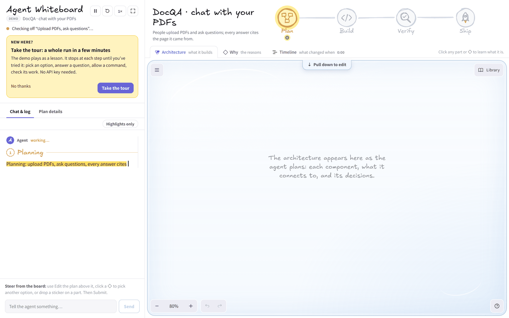
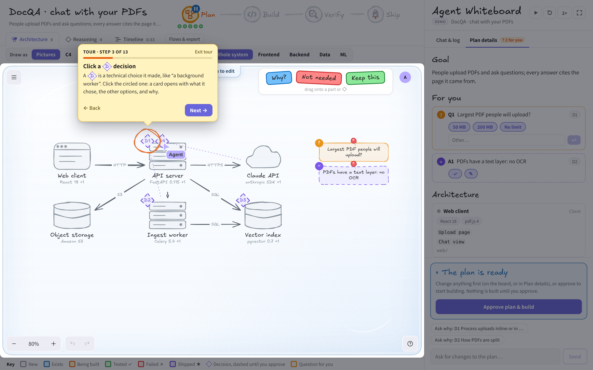

# Agent Whiteboard: a first tutorial

This guide takes you through one whole run, step by step. You don't need an API key: everything here works with the built-in demo, which never touches your files. It takes about 15 minutes.

**What you'll learn:** how a coding agent plans, builds and tests a change; how to steer it by editing a drawing of its plan; and how to check whether what it tells you is actually true.

**Words you'll see:**

- **Agent:** a program that uses an AI model to work on code by itself: it reads files, edits them and runs commands.
- **Run:** one task from start to finish: plan → build → verify (test) → ship.
- **Board:** the drawing on the right. It's the agent's plan as a picture, and you can edit it.
- **Part (component):** one piece of the system, like the web page, the server or the database.
- **Decision (◇):** a technical choice the agent made, like "use a background worker".

---

## 1. Set it up

You need [Node.js](https://nodejs.org) 20 or newer, and git. In a terminal:

```bash
git clone https://github.com/ghanemja/whiteboard.git
cd whiteboard
npm install          # downloads the libraries it uses
npm run sandbox      # makes a small practice repo in sandbox/linkshort
npm run dev          # starts the app
```

Open **http://localhost:5199** in your browser. Without an API key, a scripted demo starts by itself. That's all you need for this tutorial.

Optional: to see three real, recorded runs under "Saved boards" (section 9), also run:

```bash
cp fixtures/recordings/* recordings/
```

## 2. Take the tour

The first time you open the app, it offers a tour. Press **Take the tour** (you can also find it on the start screen, or as **Tour** in the yellow tips card).



The tour plays the demo as a lesson. A yellow card on the left says what to do and why, and orange rings or sticky notes point at the thing to click. The demo **waits for you** at each step, so take your time. If you get stuck, **Skip step** does it for you; **Back** shows the last step again; **Exit tour** leaves it (the demo keeps going as normal).

The rest of this guide covers the same run in more detail. Do the tour first, then read on, or follow along here instead.

## 3. The three areas


1. **The panel (left).** The agent talks here, and you answer. It has two tabs: **Chat & log** (what it said and did) and **Plan details** (the plan in words). The box at the bottom is for typing to it.
2. **The board (right).** The plan as a drawing. Each picture is a part of the system; arrows show which part talks to which.
3. **The phase road (top).** Where the run is: **Plan → Build → Verify → Ship**, with a dot for each task.

## 4. A first run, end to end

### It plans

The agent reads the task and draws its plan. Parts appear one by one. The picture says what kind of part it is (a browser window is a web client, a server rack is a server, a cylinder is a database, a cloud is someone else's service), and the **color says its state**. The key under the board lists them all: grey = new (not built yet), orange = being built, green = tested, red = a test failed, purple = shipped.


When the plan is ready, the agent **stops and waits for you**. The Plan milestone gets a blue ⏸, and a "The plan is ready" card appears at the bottom of the panel. Nothing gets built until you approve.

### Look at a decision

Diamonds (◇ D1, D2, …) are the agent's technical decisions. Click one. A card opens with what it chose, what else it could have chosen (**Instead of**), **why**, and the check that will prove it right (**We'll know it's right when**).



Dashed diamonds are *proposed*: you haven't approved them yet.

### Approve

When you're happy with the plan, press **Approve plan & build** (or **Approve with changes** if you changed something; see section 5). The agent starts building.


### It builds

Now it edits files by itself. Parts turn **orange** while it changes them. In **Chat & log**, hover any sentence: the parts that sentence changed light up on the board. Under each part, small green and red blocks show how many lines it added and removed.


### It tests (verify)

Each decision came with a check. When it runs the tests, each ◇ gets a ✓ (passed) or ✗ (failed). In the demo, D2 ("how PDFs are split") fails: the check wanted the right page for 45 of 50 questions, and it got 41. So the agent **changes D2** and tests again: 47 of 50, ✓.

Open the **Why** tab to see the reasoning as a chain: **evidence → decision → what it shapes → proof**. D2's row shows the failed check as the reason it changed.


### It ships

The last phase deploys it. All parts turn purple (★ shipped), and a flag appears at the end of the road.

## 5. Steer it: change the plan

You don't have to type to change its mind. **Edit the board**, and your changes are sent to the agent. They work best at the plan gate, before anything is built, but you can send them later too.

### Pull the glass down

The board sits **behind glass**, like a fishbowl: a faint blue sheen over the drawing. Through the glass you can look and **click anything** to learn what it is, but you can't move or change things by accident. To change the plan, press **Pull down to edit** (the tab at the top of the board) or **Pull the glass down to change the plan** (above it). The glass slides away and the **Edit the plan** toolbar appears. When you **Submit**, your changes go to the agent and the glass comes back up. **Glass back up** puts it back without sending anything; your changes wait in the list.


Buttons on a card that change the plan (**Use this**, **Rename**, **Remove**) pull the glass down for you.

### Pick another option for a decision

Click a ◇, then press **Use this** next to one of the other options. Or drag one of the option pills that fan out beside the diamond onto it. To use your own idea, type it in the blank "+ your own" pill.


### Use the Edit the plan toolbar

With the glass down, **Edit the plan** above the board has buttons with words:

| Button | What it does |
| --- | --- |
| **Rename** | Change a part's name, for example to swap a technology ("Postgres" → "SQLite") |
| **Add a part** | Draw a box and name it: "I want this too" |
| **Connect** | Draw an arrow from one part to another |
| **Remove** | Remove the selected part or arrow, or reject the selected ◇ |
| **Add a note** | Write a note on the board, like "English PDFs only" |
| **Stickers** | Opens the sticker sheet (below) |

### Stickers

Press **Stickers** and drag one onto a part or a ◇:

- **Why?** asks it to explain (it changes nothing).
- **Not needed** asks it to drop that part or decision.
- **Keep this** tells it not to change that without asking you.


### Send your changes

Your changes collect in a list at the bottom of the panel. At the plan gate:

- **Revise plan** redraws the plan with your changes and asks you again.
- **Approve with changes** folds them in and starts building.

Later on, press **Submit** (on the board or in the panel). Either way, the glass goes back up.

### Answer its questions

Sometimes the agent can't tell something from the code, so it asks you. Questions are orange sticky notes on the board (with a push pin), and **Plan details** shows "? 2 for you". Click the note, or open Plan details, and pick an answer or type your own. **Assumptions** (purple notes, ≈) are things it decided to believe; confirm one (✓) or correct it (✎).


You can also just type in the box at the bottom ("Use SQLite instead"), or press **Ask why** on a decision.

## 6. See it other ways: Draw as and Zoom into

The bar right above the board shows the same plan in other ways. Try it on any plan; it never changes the plan.


**Draw as** redraws the board in a standard notation:

| Draw as | What you see |
| --- | --- |
| **Pictures** | The pictograms (the default) |
| **C4** | The official C4 container diagram: each part's type and technology |
| **Data flow** | Processes, data stores and outside services, with the data on each arrow |
| **Database** | The tables each data store holds: columns, keys, and how they relate (an ER diagram) |
| **Sequence** | One request, step by step, as a sequence diagram (pick the flow under **Flows & export**) |

**Zoom into** opens one **layer** of the system, so you see what's *inside* its parts instead of just boxes. The map stays the same: each part of that layer becomes a frame with its pieces inside, and parts from other layers stay closed, as grey boxes, where they were.

- **Frontend**: the pages and views (in the demo: the upload page, the chat view, the PDF page viewer) and the calls they make.
- **Backend**: the routes and jobs (`POST /documents`, `POST /ask`, `ingest(document_id)`) and where each one hands its work.
- **Data**: the tables with their columns, the files in storage, and the indexes.
- **ML**: the model pipeline, even where its steps live inside backend parts. In the demo: chunk → embed → the vector index, and retrieve top 8 → prompt → Claude writes the answer.


**Whole system** goes back to the full board. You can also click a part and press **Look inside** on its card. Zoomed-in views are read-only; to change something, go back to Whole system. **Flows & export** copies any view as Mermaid (GitHub renders it) or saves it as SVG or PNG.

## 7. The command prompt

An agent can run commands, and a command can do anything your terminal can: delete files, install things, send data. So it **asks before every command**.


- **Allow once:** run this one command.
- **Allow all:** run every command for the rest of this run, without asking.
- **Deny:** don't run it. The agent finds another way, or tells you why it needs it.

Read the command first. Running the tests (`npm test`, `pytest`) is usually fine. Be careful with anything that deletes (`rm`), installs, pushes or deploys. When in doubt, Deny. Editing files inside the repo doesn't ask, because you approved the plan.

(The demo only shows this prompt during the tour. With a real agent, it appears for every command.)

## 8. Check its work

Agents can be wrong about their own work, and they say so confidently. So the app checks what it said against what really happened: **git** (which files actually changed) and **the test output**.

### Receipts

Sentences that claim something checkable get a receipt in Chat & log:

- **✓ checked:** the record backs it up.
- **? can't tell:** nothing in the record says either way.
- **✗ not true:** the record contradicts it.

The **Chat & log** tab shows how many are not true ("✗ 1 not true").

### The Review card

When the run ends, a **Review** card at the end of Chat & log lists what to look at, worst first. In the demo, the agent says it "documented the setup in README.md", but no README.md changed. That's the ✗ **False claim** row. Click its link to jump to the sentence.


### Red pen

The review is also marked on the board in red pen, the way a teacher marks homework: a ring round the part that owns a file a false claim names, a ✗ over a decision whose check failed, or a margin note under the board for a file no part owns (like the demo's README.md). Click a mark to open what it's about.


### The Timeline

The **Timeline** tab shows the whole run over time: your actions on top (pink), test runs (✓ ✗), then one lane per decision from proposed (dashed) to approved (solid) to proven (✓). Arrows show *why* something changed: from your click, or from a failed test. In the demo, find D2's ✗ and the change right after it.


## 9. Saved runs and the decision log

Every run is recorded. The start screen lists them under **Saved boards**. With an API key, that's where you begin; with the demo, press **See saved runs** on the tour's last step. (To see the three sample runs, copy them first, see section 1.)


- **Replay** plays the run back as it happened. Pause, change the speed, or click any moment on the Timeline to jump there.
- **Open** shows the board as it ended.
- **Decisions** opens the **decision log**: a readable file with the final plan (goal, parts, connections, each decision with why, its check and its proof) and a timeline of who decided what, and when. It's saved next to the recording as `recordings/<id>.decisions.md`, so you can paste it into a pull request.


## 10. Your own task (needs an API key)

To run a real agent instead of the demo:

1. Copy the example settings: `cp .env.example .env.local`.
2. Put your key in it: `AGENT_KEY=sk-ant-…` (an [Anthropic API key](https://console.anthropic.com); the README's *Models* section has other options).
3. Restart `npm run dev`.

Now the start screen asks **What should the agent do?** The repository field starts at the practice repo (`sandbox/linkshort`, a tiny URL shortener with tests). Pick one of the example tasks, like "Let links expire after a given number of days", or describe your own. Everything from sections 4–9 works the same, except the commands are real now, so read each prompt. To reset the practice repo, run `npm run sandbox` again.

A run costs about $0.20–0.40.

## Tips

- The yellow **tips** card always says which step you're on and what to do. **Hide tips** puts it away; the **?** button brings it back.
- Click anything on the board to learn what it is.
- **Highlights only** (in Chat & log) hides the narration and keeps what matters.
- **Draw as** and **Zoom into** (above the board) show the plan other ways; **Flows & export** shows one flow's steps and exports the view as Mermaid, SVG or PNG.
- The glass over the board keeps clicks safe: pull it down to change things.
- The ▶ / ⏸ button pauses the demo; **2×** changes its speed.

Questions or ideas? Open an issue on [GitHub](https://github.com/ghanemja/whiteboard/issues).
